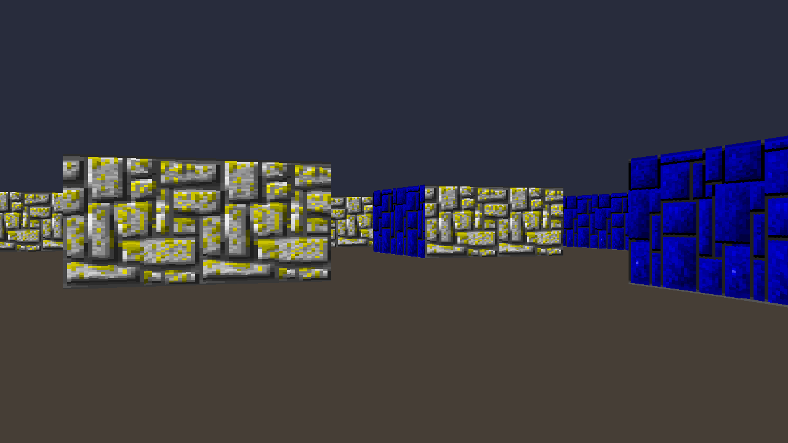
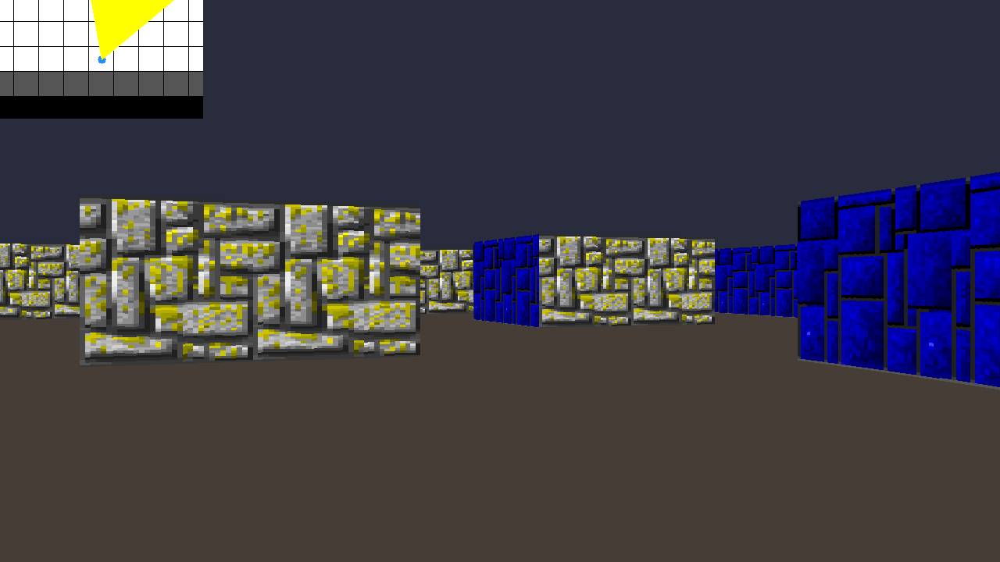
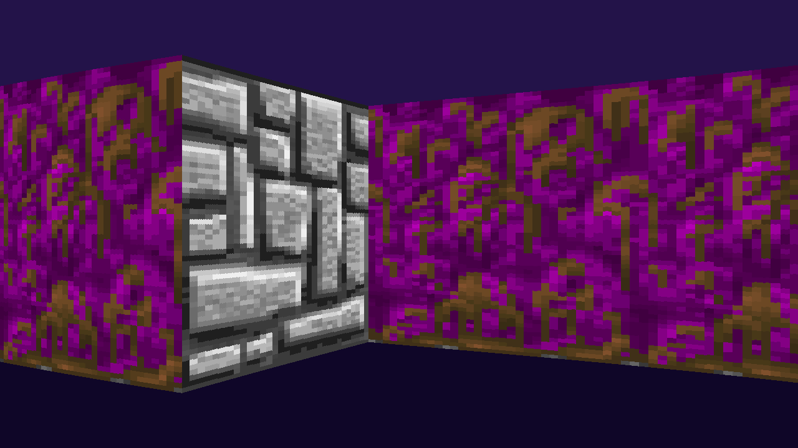

<div align="center">

```
░█████╗░██╗░░░██╗██████╗░  ██████╗░██████╗░
██╔══██╗██║░░░██║██╔══██╗  ╚════██╗██╔══██╗
██║░░╚═╝██║░░░██║██████╦╝  ░█████╔╝██║░░██║
██║░░██╗██║░░░██║██╔══██╗  ░╚═══██╗██║░░██║
╚█████╔╝╚██████╔╝██████╦╝  ██████╔╝██████╔╝
░╚════╝░░╚═════╝░╚═════╝░  ╚═════╝░╚═════╝░
```

**A raycasting engine written in C, made for the 42 curriculum.**




</div>

---

## About

cub3D turns a flat 2D grid into a 3D world you can walk through, using the same trick the
early-90s shooters used: **raycasting**. For every column on the screen we send one ray into
the map, find the first wall it hits, and draw a textured vertical stripe whose height depends
on how far away the wall is.

No 3D engine and no GPU shaders: just math, a grid and a pixel buffer.

## Screenshots

<table>
  <tr>
    <td></td>
    <td></td>
  </tr>
  <tr>
    <td align="center"><sub>Minimap (<code>TAB</code>) with the cast rays (<code>R</code>)</sub></td>
    <td align="center"><sub><code>maps/creepy.cub</code>: custom floor &amp; ceiling colours</sub></td>
  </tr>
</table>

## Features

- 🧱 **Textured walls** with a different texture for each direction (N / S / E / W)
- 🎨 **Floor and ceiling colours** set in the map file
- ⚡ **DDA raycasting**: fast grid traversal, one ray per screen column
- 🗺️ **Toggleable minimap** that follows the player
- 🔦 **Ray visualisation** on the minimap, so you can see the rays being cast
- 🪟 **Resizable window**: the view re-renders at the new size
- 🛡️ **Strict map validation**: walls must be closed, there must be exactly one player, and the textures and RGB values are checked

## Getting started

### Requirements

MLX42 needs CMake, GLFW and OpenGL. On Ubuntu/Debian:

```bash
sudo apt install build-essential cmake libgl1-mesa-dev libglfw3-dev libx11-dev xorg-dev
```

On macOS: `brew install cmake glfw`

### Build & run

```bash
git clone https://github.com/jofmann/cub3d.git && cd cub3d
make
./cub3d maps/libary.cub
```

The Makefile downloads [MLX42](https://github.com/codam-coding-college/MLX42) automatically,
pins it to a fixed commit and builds it.

| Command      | Description                                   |
| ------------ | --------------------------------------------- |
| `make`       | Build `cub3d` (and MLX42 / libft if needed)   |
| `make debug` | Rebuild with `-fsanitize=address -g`          |
| `make clean` | Remove object files                           |
| `make fclean`| Remove object files, binary and MLX42         |
| `make re`    | Full rebuild                                  |

## Controls

| Key            | Action                          |
| -------------- | ------------------------------- |
| `W` `A` `S` `D`| Move forward / left / back / right |
| `←` `→`        | Rotate the camera               |
| `TAB`          | Toggle the minimap              |
| `R`            | Toggle the rays on the minimap  |
| `ESC`          | Quit                            |

## Map format (`.cub`)

```
NO textures/wolfenstein/purplestone.png
SO textures/wolfenstein/redbrick.png
WE textures/wolfenstein/greystone.png
EA textures/wolfenstein/wood.png

F 139,99,58
C 171,154,137

1111111111111111111
1001001001001001001
100000000S000000001
1000011111111000001
1111111111111111111
```

| Element           | Meaning                                       |
| ----------------- | --------------------------------------------- |
| `NO` `SO` `WE` `EA` | Path to the wall texture (`.png`) for each direction |
| `F` / `C`         | Floor / ceiling colour as `R,G,B` (0–255)     |
| `1`               | Wall                                          |
| `0`               | Empty floor                                   |
| `N` `S` `E` `W`   | Player start position and viewing direction  |

The map has to be fully enclosed by walls. On any problem the program prints `Error` followed
by a short explanation and exits.

The repo includes a few maps to try: `showcase`, `libary`, `dungeon`, `creepy` and `square`.

## How it works

```
 parse .cub ──► validate ──► init MLX ──► game loop
                                            │
                     ┌──────────────────────┤
                     ▼                      ▼
              handle input           cast rays (DDA)
            (move / rotate)                 │
                                            ▼
                                 draw walls, floor, ceiling
                                            │
                                            ▼
                                      draw minimap
```

1. **Parsing & validation** (`src/parse`, `src/validation`): reads the textures, colours and the
   grid, and rejects open maps, unknown characters or a missing/duplicate player.
2. **Raycasting** (`src/game/raycaster`): for each screen column a ray goes out from the player.
   The DDA algorithm steps from grid line to grid line until it hits a wall, which gives the
   exact distance and which side of the wall was hit.
3. **Rendering** (`src/game/render`): the ray distance is corrected for the fish-eye effect
   (`dist * cos(ray_angle - player_angle)`) and then gives the wall height. The texture column is picked from the exact hit point.
4. **Minimap** (`src/game/draw`): a top-down view of the area around the player, optionally
   with the cast rays drawn on top.

## Project structure

```
cub3d/
├── include/          # headers (cub3d.h, types.h, utils.h)
├── libs/
│   ├── libft/        # our own C standard library
│   └── mlx/          # MLX42 (downloaded by make)
├── maps/             # example .cub maps
├── textures/         # wall textures
└── src/
    ├── init/         # MLX + image setup
    ├── parse/        # .cub file parsing
    ├── validation/   # map & input checks
    ├── game/
    │   ├── raycaster/  # DDA
    │   ├── render/     # 3D walls
    │   ├── draw/       # minimap, player, lines
    │   ├── movement/   # move & rotate
    │   └── events/     # keys, resize, close
    └── utils/        # helpers, error handling, cleanup
```

## Authors

Made with ☕ and a lot of trigonometry by:

- **Philipp Hofmann**: [@jofmann](https://github.com/jofmann)
- **Christian Wolf**: [@cwolf777](https://github.com/cwolf777)

---

<div align="center">
<sub>42 School project · cub3D</sub>
</div>
